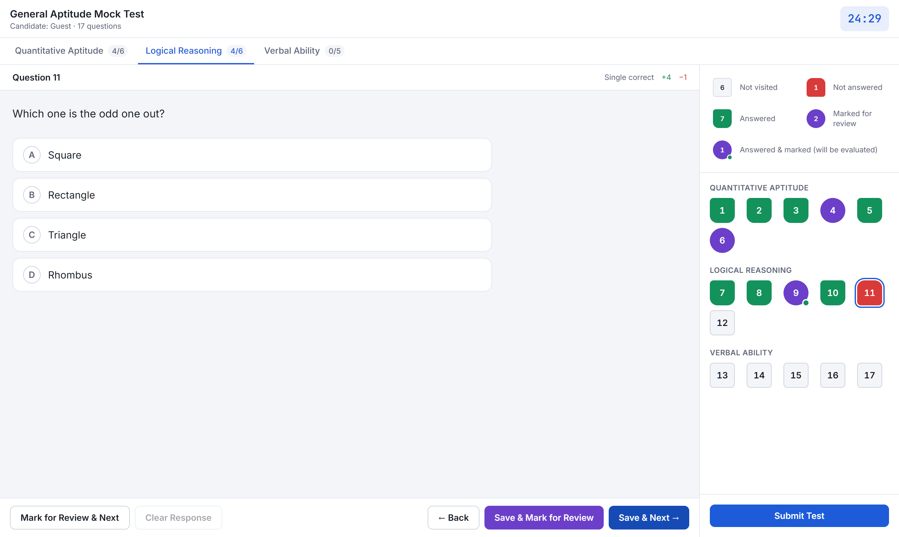
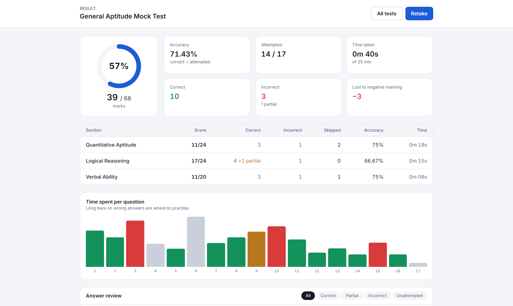

# CBT Exam Engine

**A computer-based test (CBT) simulator: the exam interface students face in JEE, NEET, CAT, SSC and banking exams, with a detailed performance report.**

[](https://github.com/sudesh1456/cbt-exam-engine/actions/workflows/ci.yml)
[](https://sudesh1456.github.io/cbt-exam-engine/)


### ▶ [Take a mock test](https://sudesh1456.github.io/cbt-exam-engine/): the 5-minute demo covers every question type



## Features

**Exam room**
- **Standard question palette** with five statuses:
  - Not visited
  - Not answered
  - Answered
  - Marked for review
  - Answered & marked, which is still evaluated
- Section tabs with progress counts, and a countdown timer that **auto-submits** at zero
- **Save & Next**, **Mark for Review & Next**, **Save & Mark for Review** and **Clear Response**, with real-exam semantics: only *saved* answers count
- Three question types: **single-correct**, **multiple-correct** and **numerical answer** (with tolerance)
- **Resume after refresh or crash**: the attempt is persisted on every action, and the timer is derived from a fixed deadline, so reloading doesn't buy extra time
- A summary before submitting, a warning before closing the tab, and a responsive layout (the palette becomes a strip on mobile)

**Marking**
- Per-section or per-question schemes: +correct / −incorrect
- **JEE Advanced-style partial marking**: multiple-correct questions earn marks per right option picked, provided no wrong option is picked

**Results**
- Score ring, accuracy, attempted count, time taken, and **marks lost to negative marking**
- Section-wise table covering score, correct, incorrect, skipped, accuracy and time
- **Time-per-question chart** coloured by outcome, which shows where slow answers were also wrong
- Answer review with your answer, the correct answer and a worked solution, filterable by outcome



**Authoring**
- Exams are plain JSON. See [`src/data/aptitude-mock.json`](src/data/aptitude-mock.json).
- Imports are validated with **Zod**, including cross-field rules (duplicate IDs, answers that aren't options), with readable errors such as `sections.0.questions.3.answer: Answer "e" is not one of the options`.

## Architecture

The exam logic is a **pure reducer** plus a **pure scorer**. React only renders state, which makes the rules easy to test and reuse, for example in a server-side scorer.

```
src/engine/
├─ schema.ts    Zod exam format + validation
├─ attempt.ts   reducer: goto / draft / save-next / mark-next / save-mark-next / clear / submit
│               (tracks per-question time on every navigation)
└─ scoring.ts   marking schemes, partial marking, numeric tolerance, section + overall analytics
src/components/ ExamRoom (question, palette, submit dialog) · Results
src/lib/        localStorage persistence
```

```ts
const attempt = startAttempt(exam, Date.now());
const next = reduce(exam, attempt, { type: 'save-next', now: Date.now() });
const result = scoreAttempt(exam, next); // { score, maxScore, sections[], questions[], accuracy, negativeMarks, … }
```

## Develop

```bash
npm install
npm run dev
npm test        # reducer, scoring (incl. partial/negative/numeric) and bundled-exam validation
```

CI runs lint, typecheck, tests and build on every push, and `main` deploys to GitHub Pages.

## Roadmap

- [ ] Question images and LaTeX (KaTeX)
- [ ] Backend for timed attempts, leaderboards and percentile against other candidates
- [ ] Question bank with tags and difficulty, and random paper generation
- [ ] Proctoring signals (tab switches, fullscreen exit)

## License

MIT © [Sudesh](https://github.com/sudesh1456). All sample questions are original.
